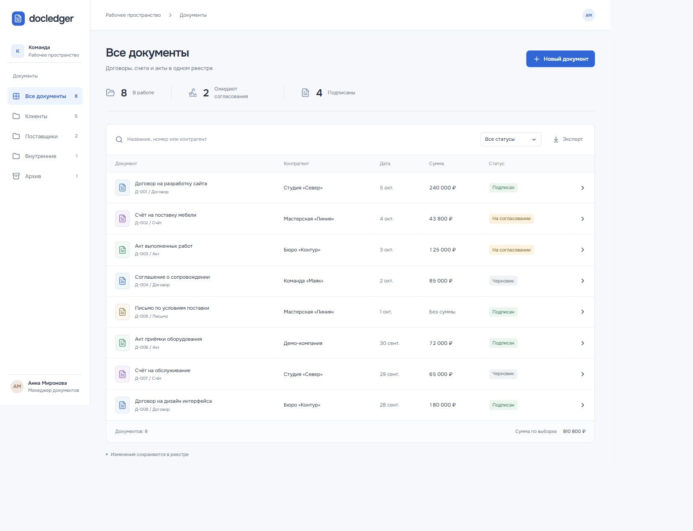

# Docledger

Реестр документов для команды: договоры, счета и акты, согласование, история изменений и архив. Карточка документа объединяет реквизиты, ответственного и текущий статус.

[](https://github.com/famelikolbut5/docledger/actions/workflows/ci.yml)



[Мобильный интерфейс](docs/mobile.png)

## Возможности

- Поиск по названию, номеру и контрагенту, разделы и фильтр статусов.
- Создание документа с проверкой полей на сервере.
- Согласование, подписание и перенос в архив.
- История создания и изменения статуса без повторных записей.
- Выгрузка реестра в CSV с защитой от формул в ячейках.

## Как устроен проект

React отвечает за реестр, фильтры и карточки. Express проверяет входящие данные и выполняет параметризованные SQL-запросы. PostgreSQL хранит документы и историю: изменение статуса и запись события проходят в одной транзакции. Повторная установка того же статуса не добавляет событие.

Суммы хранятся целыми числами в копейках. Экспорт строится на сервере из сохранённых данных.

**Стек:** React, TypeScript, Node.js, Express, PostgreSQL, Zod, Vite.

## Структура

```text
src/             интерфейс, формы и работа с API
server/          HTTP API, валидация и PostgreSQL
public/fonts/    локальные шрифты и лицензии
tests/           интеграционные проверки API и базы данных
docs/            запуск, результаты проверок и изображения
compose.yml      приложение и PostgreSQL с постоянным томом
Dockerfile       сборка интерфейса и серверной части
```

## Запуск

Нужны Git и Docker. Порт 8000 должен быть свободен.

```sh
git clone https://github.com/famelikolbut5/docledger.git
cd docledger
docker compose up --build
```

Откройте [localhost:8000](http://localhost:8000). При первом запуске база заполняется вымышленными примерами. Последующие запуски сохраняют изменения.

[Настройки и локальная разработка](docs/RUNNING.md).

## Состав демоверсии

Самостоятельное приложение с тестовыми данными. Коммерческий код, клиентские документы и контакты не включены. Демо запускается локально, без авторизации пользователей. Загрузка файлов и подключение к корпоративному хранилищу не реализованы.

[Проверки и результаты](docs/VALIDATION.md) | [Лицензии](THIRD_PARTY.md) | [MIT](LICENSE)
